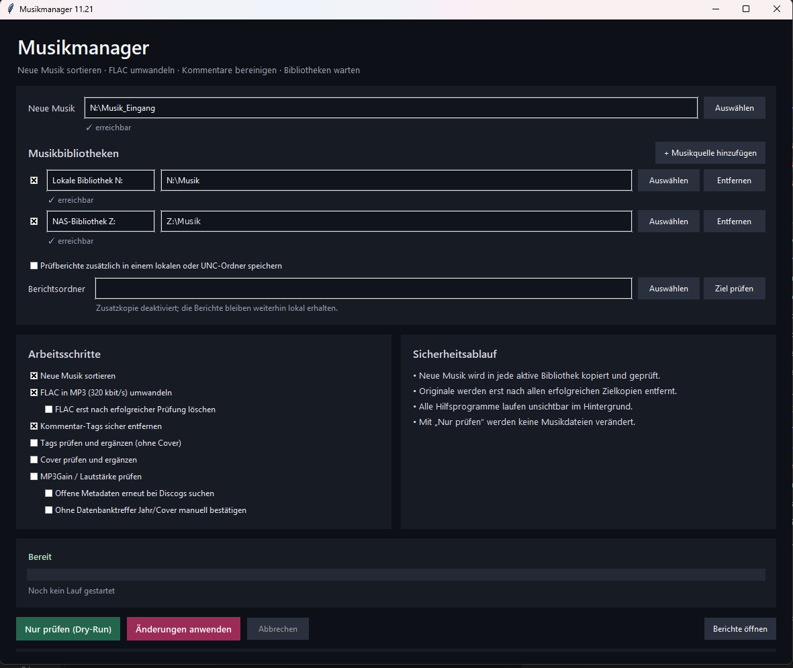
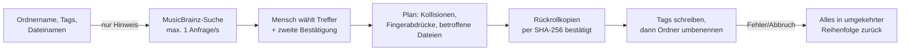

# Musikmanager – Demo

Windows-Desktop-Tool zur Pflege einer großen privaten Musiksammlung: Tags prüfen und ergänzen, Cover nachtragen, Lautstärke angleichen, Alben einsortieren und FLAC konvertieren – mit der Grundregel, dass **nichts ohne Probelauf, Bestätigung und Rückrollkopie verändert wird**.

> **Dies ist ein Demo-Repository.** Es enthält eine Projektbeschreibung und ein lauffähiges Kernmodul mit Tests. Die vollständige Anwendung ist nicht öffentlich.



## Funktionen der vollständigen App

- **Tags** – Interpret, Titel, Album, Jahr, Track-/Disknummern prüfen und sicher ergänzen (Abgleich mit Discogs)
- **Cover** – fehlende eingebettete Cover lokal oder über Discogs nachtragen, ohne Text-Tags anzufassen
- **MP3Gain** – nur Lautstärke prüfen und angleichen
- **Kommentarbereinigung, Sortieren, FLAC-Konvertierung** als eigene Schritte
- **Künstlerprüfung** – Tippfehler in Künstlernamen über MusicBrainz finden und gruppenweise korrigieren
- **Bestandscache und Berichte** – bereits geprüfte Releases werden übersprungen; jeder Lauf erzeugt einen Bericht
- **Probelauf (Dry-Run)** – verändert weder Musikdateien noch den Cache

Jeder Arbeitsschritt ist einzeln wählbar; die Auswahl wird gespeichert.

## Die Kernidee: lokale Daten sind Hinweise, keine Beweise

Ein Tippfehler wie `Brinstorm` steht oft in vielen Dateien gleichzeitig. Dass er häufig vorkommt, macht ihn nicht richtig. Deshalb:



- Kein Treffer wird automatisch übernommen.
- Ein vorhandener Zielordner blockiert die Korrektur – Ordner werden **nie** automatisch zusammengeführt.
- Nur Tags, die exakt zum alten Namen gehören, werden geändert. Gastmusiker und abweichende Track-Interpreten bleiben erhalten.
- Wurde eine Datei seit der Prüfung verändert, bricht der Lauf vor dem ersten Schreibzugriff ab.
- Windows-Eigenheiten werden beachtet: `A.C.A.B.` kann als Ordner nur `A.C.A.B` heißen, `CON` oder `AUX` sind reservierte Namen.

## Was in diesem Repository liegt

| Datei | Inhalt |
|---|---|
| `musik_demo/names.py` | Namensvergleich und sichere Windows-Ordnernamen |
| `musik_demo/correction.py` | Korrektur als Gruppe: Plan, Probelauf, Ausführung, Rückrollen |
| `musik_demo/demo_tags.py` | Text-Ersatz für Audio-Tags, damit die Demo ohne Musikdateien läuft |
| `demo.py` | Durchlauf mit simuliertem Schreibfehler und anschließender Korrektur |
| `tests/` | 13 Tests mit `unittest` |

Die Module sind gekürzte Auszüge aus der echten Anwendung. In der App schreibt `mutagen` echte ID3-/FLAC-Tags, und der neue Name stammt aus einem bestätigten MusicBrainz-Treffer. Alle Bibliotheksdaten in der Demo sind erfunden.

## Ausprobieren

Python 3.10 oder neuer, keine weiteren Pakete nötig. Die Demo arbeitet in einem temporären Ordner.

```bash
python demo.py
python -m unittest discover -v
```

Ausgabe von `demo.py` (gekürzt):

```text
Probelauf:
  [PLAN] Tag 2024 - Northern Static/01.demo: Brinstorm → Brainstorm
  [PLAN] Ordner Brinstorm → Brainstorm
  [UNVERÄNDERT] Brinstorm feat. Ada Rook

Ausführung mit simuliertem Schreibfehler:
  [TAG KORRIGIERT] 2024 - Northern Static/01.demo: Brinstorm → Brainstorm
  [RÜCKROLLEN ERFOLGREICH] Alle begonnenen Änderungen wurden zurückgenommen.
```

## Technik der vollständigen App

Python · Tkinter · mutagen · FFmpeg (über imageio-ffmpeg) · MP3Gain · Discogs-API · MusicBrainz-API · `unittest` (39 Tests in Version 11.21, darunter Tests mit echten MP3-Dateien, die danach mit FFmpeg fehlerfrei dekodiert werden)

Seit September 2026 in über 20 Versionen gewachsen – jede Version mit Prüfbericht.

---

Entwickelt von **Mandy Koch** · [GitHub](https://github.com/Skulli485) · [LinkedIn](https://linkedin.com/in/mandy-koch-85b7ab2b9)
Code © 2026 Mandy Koch. Zum Ansehen und Ausprobieren freigegeben, keine Lizenz zur Weiterverwendung.
